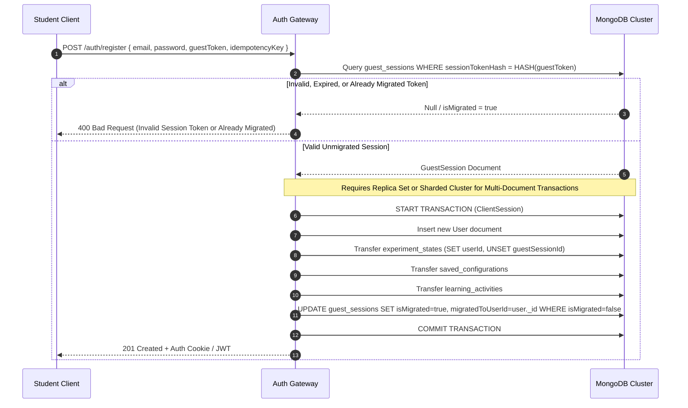

# Day 06 — Visual Labs Database Architecture Audit & Data Model Specification

**Project:** Visual Labs for Learning Science  
**Lead Architect & Database Designer:** AMAN SYED  
**Workspace:** `C:\Users\Aman Syed\visual-labs` (MAIN Repository)  
**Date:** 21 November 2026  
**Status:** Architecture Audit & Conceptual Database Design Complete  

---

## 1. Executive Summary & Context

Visual Labs for Learning Science is currently a client-side Single Page Application (SPA) built using React 19, Vite 8, and CSS. The platform delivers interactive simulation laboratories covering 12 academic modules across Class 10, Class 11, and Class 12 in Physics, Chemistry, and Biology.

This document serves as the **Day 06 Database Architecture Audit and Design Milestone**. It bridges the existing front-end implementation with the forthcoming Day 07 MongoDB persistence layer.

### Core Objectives
1. **System Audit:** Document the exact representation of academic entities, routing bindings, simulation states, and architectural debt in the existing codebase.
2. **Product Requirement Modeling:** Formalize multi-tenant student security, guest gating (maximum 4 experiments per class), cryptographically verified guest-to-user migration, debounced state persistence, and a provisional 10-day account recovery lifecycle proposal (subject to qualified legal and privacy review).
3. **Multi-Dimensional Learning Progress:** Decouple concept exploration, study completion, activity execution, and academic mastery into independent evaluative dimensions, strictly enforcing configurable, concept-specific study completion requirements (spanning reading material, interactive laboratory activities, and formative checks) while maintaining an explicit separation between study completion and verified academic mastery.
4. **Production MongoDB Data Model:** Specify comprehensive document structures, embedding vs. referencing trade-offs, partial-filter index designs (resolving user vs. guest uniqueness conflicts), parameter validation synchronization, and event-sourced progress recalculation.

> [!NOTE]
> **Scope & Safety Notice:** This milestone is strictly an architectural audit and design exercise. No application source files (`src/*`) are modified, no database connections are initiated, and no external npm packages are installed during Day 06.

---

## 2. Phase A — Existing Data Architecture Audit

### 2.1 Representation of Experiments
In the current application, experiments are represented as a monolithic array of JavaScript objects named `EXPERIMENTS`, exported from [src/data/experimentsData.js](file:///C:/Users/Aman%20Syed/visual-labs/src/data/experimentsData.js).

Each object encapsulates both routing metadata and deeply nested pedagogical content:
- **Canonical Routing Identifiers:** `id` (e.g. `'projectile-motion'`), `subjectId` (e.g. `'physics'`), `classId` (e.g. `'11'`), `status` (`'active'`).
- **Editorial Classification:** `title`, `subtitle`, `category`, `scope` (`'ncert'` | `'supplementary'`), `badge`, `description`.
- **Pedagogical Content Sub-Structures:**
  - `theory`: `{ overview: string, principles: string[], formulas: { symbol, name, formula, explanation }[], objectives: string[] }`
  - `practical`: `{ aim: string, apparatus: string[], procedure: string[], precautions: string[] }`
  - `observations`: `{ description: string, tableHeaders: string[], tableRows: string[][], notes: string }`
  - `results`: `{ interpretation: string, conclusion: string }`

```javascript
// Excerpt from src/data/experimentsData.js
export const EXPERIMENTS = [
  {
    id: 'projectile-motion',
    subjectId: 'physics',
    classId: '11',
    status: 'active',
    title: 'Projectile Motion & 2D Kinematics',
    subtitle: 'Parabolic Trajectory, Vector Independence & Range Optimization',
    category: 'Class 11 NCERT Chapter 4',
    scope: 'ncert',
    badge: 'CORE NCERT EXPERIMENT',
    theory: { ... },
    practical: { ... },
    observations: { ... },
    results: { ... }
  },
  // ... 11 additional experiment objects
]
```

### 2.2 Representation of Classes, Subjects, and Chapters
The existing architecture fractures curriculum data across two files:

1. **Academic Classes:** Defined in `CLASSES_INFO` inside [src/data/experimentsData.js](file:///C:/Users/Aman%20Syed/visual-labs/src/data/experimentsData.js) as a dictionary keyed by string class standards (`'10'`, `'11'`, `'12'`). It holds metadata (`name`, `levelLabel`, `curriculum`, `statusBadge`) and an embedded array of subjects.
2. **Subject Disciplines:** Defined in [src/data/curriculumData.js](file:///C:/Users/Aman%20Syed/visual-labs/src/data/curriculumData.js) across three independent arrays (`CLASS_10_SUBJECTS`, `CURRICULUM_SUBJECTS`, `CLASS_12_SUBJECTS`), combined in `CLASS_SUBJECTS_MAP`. Each subject contains `code`, `name`, `discipline`, `topic`, `chapter`, `description`, `topics: string[]`, `accent`, and `activeTab`.
3. **Curriculum Chapters:** **No dedicated Chapter entity exists.** Chapters are merely denormalized strings embedded in subject records (e.g., `chapter: 'Chapter 4: Motion in a Plane'`) and experiment categories (e.g., `category: 'Class 11 NCERT Chapter 4'`). They lack independent identifiers, sequence numbers, or learning objectives.

### 2.3 Experiment Identifiers & Routing Associations
Visual Labs supports exactly **12 functional experiments** across three academic levels. The following table maps the authentic identifiers discovered in the codebase:

| Academic Level | Discipline | Canonical Experiment ID (`id`) | Route Path | Component Mapping | Scope |
|---|---|---|---|---|---|
| **Class 10** | Physics | `magnetism` | `/classes/10/physics/magnetism` | `MagneticFieldSimulation.jsx` | NCERT Core |
| **Class 10** | Chemistry | `periodic-classification` | `/classes/10/chemistry/periodic-classification` | `PeriodicTableSimulation.jsx` | NCERT Core |
| **Class 10** | Biology | `life-processes` | `/classes/10/biology/life-processes` | `LifeProcessesSimulation.jsx` | NCERT Core |
| **Class 11** | Physics | `projectile-motion` | `/classes/11/physics/projectile-motion` | `ProjectileSimulation.jsx` | NCERT Core |
| **Class 11** | Physics | `pendulum` | `/classes/11/physics/pendulum` | `PendulumSimulation.jsx` | Supplementary |
| **Class 11** | Chemistry | `mole-concept` | `/classes/11/chemistry/mole-concept` | `MoleConceptSimulation.jsx` | NCERT Core |
| **Class 11** | Chemistry | `titration` | `/classes/11/chemistry/titration` | `TitrationSimulation.jsx` | Supplementary |
| **Class 11** | Biology | `plant-kingdom` | `/classes/11/biology/plant-kingdom` | `PlantKingdomSimulation.jsx` | NCERT Core |
| **Class 11** | Biology | `enzyme-kinetics` | `/classes/11/biology/enzyme-kinetics` | `EnzymeSimulation.jsx` | Supplementary |
| **Class 12** | Physics | `moving-charges-magnetism` | `/classes/12/physics/moving-charges-magnetism` | `LorentzForceSimulation.jsx` | NCERT Core |
| **Class 12** | Chemistry | `electrochemistry` | `/classes/12/chemistry/electrochemistry` | `ElectrochemistrySimulation.jsx` | NCERT Core |
| **Class 12** | Biology | `genetics-principles` | `/classes/12/biology/genetics-principles` | `GeneticsSimulation.jsx` | NCERT Core |

#### Routing & Dispatch Execution Path
1. [src/router/routeMatcher.js](file:///C:/Users/Aman%20Syed/visual-labs/src/router/routeMatcher.js) validates URL patterns against `SUPPORTED_CLASSES` (`Set(['10', '11', '12'])`) and `SUPPORTED_SUBJECTS` (`Set(['physics', 'chemistry', 'biology'])`).
2. Route parser verifies that `getExperiment(classId, subjectId, experimentId)` returns an experiment object.
3. [src/pages/ExperimentDashboardPage.jsx](file:///C:/Users/Aman%20Syed/visual-labs/src/pages/ExperimentDashboardPage.jsx) dispatches the live simulation component via a rigid `switch (experiment.id)` block.

### 2.4 Simulation Parameters & Default Values
Simulation parameters, operational boundaries, and defaults are **hardcoded directly within individual simulation components** using React `useState` hooks. There is no central schema defining parameter types or valid intervals:

- `ProjectileSimulation.jsx`: `velocity = 25` (min: 10, max: 50, step: 1), `angle = 45` (min: 15, max: 75, step: 1).
- `PendulumSimulation.jsx`: `length = 1.0` (min: 0.5, max: 2.5), `gravity = 9.8` (presets: Moon 1.6, Mars 3.7, Earth 9.8, Jupiter 24.8), `amplitude = 15`.
- `MoleConceptSimulation.jsx`: `selectedEntity = 'water'`, `moles = 1.0` (min: 0.1, max: 5.0).
- `TitrationSimulation.jsx`: `titrantVolume = 0.0` (min: 0.0, max: 50.0), `analyteConcentration = 0.10` (min: 0.05, max: 0.20).
- `PlantKingdomSimulation.jsx`: `selectedDivision = 'algae'`, `activeFilter = 'all'`.
- `EnzymeSimulation.jsx`: `substrateConc = 5.0` (min: 0.5, max: 20.0), constants: $V_{\max} = 120$, $K_m = 3.0$.
- `MagneticFieldSimulation.jsx`: `mode = 'wire'`, `current = 5.0` (min: 0, max: 10), `direction = 'up'`, `distance = 4.0` (min: 1, max: 8), `solenoidTurns = 20` (min: 5, max: 50).
- `PeriodicTableSimulation.jsx`: `selectedZ = 11` (min: 1, max: 20), `activeTrend = 'radius'`.
- `LifeProcessesSimulation.jsx`: `lightIntensity = 70` (min: 0, max: 100), `co2Level = 400` (min: 100, max: 800), `waterStatus = 80` (min: 10, max: 100).
- `LorentzForceSimulation.jsx`: `particleKey = 'electron'`, `bField = 0.8` (min: 0.1, max: 2.0), `velocity = 5.0` (min: 1.0, max: 10.0), `angleDeg = 90` (min: 15, max: 90).
- `ElectrochemistrySimulation.jsx`: `coupleKey = 'zn_cu'`, `cAnode = 1.0` (min: 0.01, max: 2.0), `cCathode = 1.0` (min: 0.01, max: 2.0), `tempK = 298` (min: 273, max: 353).
- `GeneticsSimulation.jsx`: `traitKey = 'height'`, `parent1 = 'hetero'`, `parent2 = 'hetero'`, `sampleSize = 100` (min: 4, max: 1000).

### 2.5 Simulation State Management & Lifecycle
- **Isolated Component State:** State is strictly encapsulated in local React component closures.
- **No State Lifting:** Parent views ([ExperimentDashboardPage.jsx](file:///C:/Users/Aman%20Syed/visual-labs/src/pages/ExperimentDashboardPage.jsx)) have no mechanism to read, serialize, or intercept parameter values.
- **Volatile Reset:** Component `handleReset()` functions manually re-invoke local state setters with literal initial constants. Navigating away unmounts the component and permanently destroys the state.

### 2.6 Static vs. Dynamic Data Breakdown

```
┌────────────────────────────────────────────────────────┐
│                   STATIC DATA (Code)                   │
├────────────────────────────────────────────────────────┤
│ • Academic Standards & Curricula                       │
│ • Subject Disciplines, Colors & Codes                  │
│ • Chapter Headings & Approved Topic Lists              │
│ • Canonical Experiment Titles & Categorizations        │
│ • Theory Overviews, Mathematical Formulas & Principles │
│ • Laboratory Protocols, Apparatus Lists & Precautions  │
│ • Reference Observation Matrices & Notes               │
│ • Scientific Results & Pedagogical Conclusions         │
│ • Parameter Range Definitions (Min, Max, Step, Unit)   │
└────────────────────────────────────────────────────────┘
                           │
                           ▼
┌────────────────────────────────────────────────────────┐
│               DYNAMIC DATA (In-Memory)                 │
├────────────────────────────────────────────────────────┤
│ • Active Browser URL Route (`RouterContext`)           │
│ • Active Dashboard Section Tab (`activeSection`)       │
│ • Real-time Slider Values (Velocity, Current, Angle)   │
│ • Mode Presets (Particle, Electrode Couple, Trait)     │
│ • Calculated Outputs (EMF, Cyclotron $r$, Pore Width)  │
│ • Ephemeral DOM Focus & Interaction Events             │
└────────────────────────────────────────────────────────┘
```

### 2.7 Verification of Persistence Mechanisms
> [!IMPORTANT]
> **Audit Finding: Zero Persistence Mechanism Exists.**  
> Codebase grep for `localStorage`, `sessionStorage`, `indexedDB`, and `document.cookie` confirms zero usage across the entire `src/` tree. The application is completely stateless. Every browser refresh or navigation restores hardcoded initial constants.

### 2.8 Duplicated, Inconsistent & Tightly Coupled Structures
1. **Redundant Subject Registries:** Subjects are defined in both `src/data/curriculumData.js` and `src/data/experimentsData.js`. This creates property divergence:
   - In `curriculumData.js`: Class 11 Physics is identified by `activeTab: 'physics'` with code `NCERT / CLASS 11 • CH-04`.
   - In `experimentsData.js`: Identified by `id: 'physics'` with code `NCERT-PHY-11-04`.
2. **Missing Relational Hierarchy:** The lack of a Chapter entity forces experiments to embed string categories like `'Class 11 NCERT Chapter 4'`.
3. **Hardcoded Component Switch:** In `ExperimentDashboardPage.jsx`, adding an experiment requires manually appending a `case` branch to `renderSimulationComponent()`.

---

## 3. Phase B — Requirements for Future Database Architecture

### 3.1 Multi-Tenant Student Accounts & Security Boundaries
- **Tenant Isolation:** Every student account is assigned an immutable, unique identifier (`userId`).
- **Authorization Scoping:** All user-specific collections (`experiment_states`, `saved_configurations`, `question_attempts`, `learning_activities`, `concept_progress`) must store `userId` as a mandatory foreign reference.
- **IDOR Prevention:** Server-side API endpoints must strictly validate that the resource's `userId` matches the cryptographically verified JWT bearer identity. Direct queries targeting arbitrary `userId` parameters must return HTTP `403 Forbidden`.

### 3.2 Guest Access Gating & Entitlement Enforcement
- **4-Experiment Gating Rule:** Unauthenticated visitors may access a maximum of **four unique experiments per academic class standard** (up to 4 in Class 10, 4 in Class 11, and 4 in Class 12).
- **Backend Enforcement:** The client must never enforce this limit alone. The backend API evaluates:
  $$\text{count}\left(\text{guest\_sessions.accessedExperiments}[\text{classId}]\right) \le 4$$
- **Enforcement Flow:**
  - Upon visiting an experiment, the server checks `accessedExperiments[classId]`.
  - If the experiment is already in the list, access is granted.
  - If it is new and the count is $< 4$, the server appends the experiment ID and sets an HMAC-signed session cookie.
  - If the count is $\ge 4$ and the experiment is unvisited, the server rejects simulation access with HTTP `403 Forbidden` (`code: "GUEST_CLASS_LIMIT_EXCEEDED"`, `requiredAction: "REGISTER"`).

### 3.3 Reliable Guest-to-User Migration Workflow



#### 3.3.1 MongoDB Deployment & Transaction Requirements
> [!IMPORTANT]
> **Deployment Topology Prerequisite:**  
> Multi-document atomic transactions in MongoDB **strictly require a deployment supporting transactions: either a replica set or an appropriately configured sharded cluster**.
> - **Standalone Instances Unsupported:** A standalone `mongod` instance does not support multi-document transactions; executing `client.startSession()` and `session.startTransaction()` on a standalone node throws an immediate runtime exception (`MongoServerError: Transaction numbers are only allowed on a replica set member or mongos`).
> - **Local Development Setup:** For local testing in Day 07 development environments, developers must initiate a single-node replica set (`mongod --replSet rs0` followed by `rs.initiate()`) or utilize an in-memory replica set runner (such as `mongodb-memory-server` configured with replica set mode).
> - **Storage Engine:** Transactions mandate the default WiredTiger storage engine.

#### 3.3.2 Concurrency, Idempotency & Duplicate Prevention
> [!WARNING]
> **Transactions Alone Do Not Solve All Concurrency or Duplicate Issues:**  
> While MongoDB multi-document transactions provide ACID atomicity and snapshot isolation *within the transaction boundary*, they do not inherently solve external application-level race conditions, network failures, or duplicate client submissions. Robust migration architecture requires defense-in-depth across both database schema constraints and application protocols:

1. **Cryptographic Identity Verification:** The `guestToken` is a 256-bit cryptographically secure random token stored in an `HttpOnly`, `SameSite=Strict` cookie, preventing token hijacking or client-side tampering.
2. **Idempotency Tokens & Double-Submit Protection:** The registration endpoint accepts a client-generated `idempotencyKey` (or binds to the unique `guestToken`). If a student double-clicks "Register" or if an aggressive browser retry triggers duplicate HTTP requests in parallel, only one transaction can successfully commit.
3. **Atomic State Condition (`isMigrated: false`):** The update to `guest_sessions` includes an atomic predicate query `{ _id: guestSessionId, isMigrated: false }`. If two concurrent transactions attempt migration on the same guest session, write conflict detection aborts the second transaction with a `WriteConflict` transient error.
4. **Database-Level Unique Constraints:** To guarantee that a guest session can never be associated with multiple user accounts under any concurrency anomaly, a unique partial index enforces uniqueness:  
   `db.guest_sessions.createIndex({ migratedToUserId: 1 }, { unique: true, partialFilterExpression: { migratedToUserId: { $type: "objectId" } } })`.
5. **State Conflict Resolution:** If the registered account already owns an `experiment_state` for an experiment that the guest also modified, the system applies a **Latest-Timestamp Merge Policy**: the state with the more recent `updatedAt` timestamp is preserved, while the older state is archived into `saved_configurations` under the label `'Auto-archived Guest Session'`.

#### 3.3.3 Recovery from Interrupted Migration
Network dropped connections and server restarts introduce real-world failure modes that transactions alone cannot prevent:
- **Failure Prior to Commit:** If the API process terminates, database connection drops, or a validation fails prior to `session.commitTransaction()`, the transaction aborts automatically. All inserted records (user profile, updated state pointers) are rolled back to their pre-transaction state. The guest session remains untouched (`isMigrated: false`), allowing the student to cleanly retry the registration request.
- **Failure Post-Commit (Client Disconnect / Timeout):** If the database successfully commits the transaction, but a network interruption prevents the HTTP `201 Created` response from reaching the client:
  - The client will inevitably retry the registration request with the same `guestToken` and credentials.
  - Rather than failing with a confusing duplicate key error or attempting duplicate document inserts, the authentication service executes an idempotent recovery path: it verifies that `guest_sessions.isMigrated === true` and that the user account exists with matching credentials.
  - The service bypasses data transfer, generates fresh JWT session credentials, and returns HTTP 200/201 to the client, seamlessly restoring the user's access.

#### 3.3.4 Alternative Workflow Considerations If Transactions Are Unavailable
If Visual Labs must be deployed in environments where multi-document transactions cannot be provisioned (such as legacy standalone instances, restricted multi-region sharded tiers with cross-shard write constraints, or decoupled microservice architectures):
1. **Two-Phase Saga Pattern with Migration State Flags:**
   - Extend `guest_sessions` with an explicit lifecycle status: `migrationStatus: 'unmigrated' | 'in_progress' | 'committed' | 'failed'`.
   - **Phase 1 (Lock):** Use an atomic single-document `findOneAndUpdate({ _id: guestId, migrationStatus: 'unmigrated' }, { $set: { migrationStatus: 'in_progress', migrationLockTime: new Date() } })`. If another process has claimed the lock, the operation fails immediately.
   - **Phase 2 (Idempotent Transfers):** Insert the user record, transfer states using upsert operations with idempotency keys (`$setOnInsert`), and archive conflicts.
   - **Phase 3 (Finalize):** Update `migrationStatus: 'committed'`, `isMigrated: true`, and link `migratedToUserId`.
2. **Compensating Rollback & Reaper Workers:**
   - If a non-transactional step fails halfway through, an asynchronous compensating routine or background reaper worker checks for sessions in `migrationStatus: 'in_progress'` whose `migrationLockTime` exceeds a timeout (e.g. 60 seconds).
   - The worker executes compensating reversals (deleting partially migrated states associated with the unconfirmed user or rolling back status to `'failed'`), enabling safe remediation without leaving orphaned or corrupt states.

### 3.4 Authoritative Experiment State & Write-Behind Caching
- **Partitioning:** The system distinguishes between:
  1. `experiment_states`: The single latest auto-saved working state per experiment (1:1 per user/guest).
  2. `saved_configurations`: User-created bookmarks with custom titles and notes (1:N per user).
- **Write-Behind Caching:** As sliders move, parameters update instantly in local React state and write to browser `IndexedDB`. A 1500ms debounce timer sends a `PUT /api/experiments/:id/state` payload to MongoDB.
- **Default Reset Guarantee:** Clicking "Reset" fetches canonical defaults from the `experiments` collection, updates client state, and overwrites `experiment_states`.

### 3.5 Multi-Dimensional Progress: Decoupling Exploration, Study, Activity & Mastery

```
                      ┌─────────────────────────────────┐
                      │       Concept Introduced        │
                      └────────────────┬────────────────┘
                                       │
            ┌──────────────────────────┴──────────────────────────┐
            ▼                                                     ▼
┌───────────────────────┐                             ┌───────────────────────┐
│      isExplored       │                             │    hasReadMaterial    │
│ (Simulation Active)   │                             │  (Theory/Practical)   │
└───────────────────────┘                             └───────────┬───────────┘
                                                                  │
                                        ┌─────────────────────────┴─────────────────────────┐
                                        ▼                                                   ▼
                            ┌───────────────────────┐                           ┌───────────────────────┐
                            │ hasCompletedActivity  │                           │  hasPassedQuestions   │
                            │  (Parameter Sweeps)   │                           │  (Formative Checks)   │
                            └───────────┬───────────┘                           └───────────┬───────────┘
                                        │                                                   │
                                        └─────────────────────────┬─────────────────────────┘
                                                                  ▼
                                                      ┌───────────────────────┐
                                                      │   isStudied = true    │
                                                      │  (Concept-Configured) │
                                                      └───────────┬───────────┘
                                                                  │
                                                                  ▼
                                                      ┌───────────────────────┐
                                                      │   isMastered = true   │
                                                      │ (Separate Evidence of │
                                                      │     Understanding)    │
                                                      └───────────────────────┘
```

The system strictly avoids a rigid sequential status enum. Progress is modeled across **orthogonal evaluative dimensions**:

1. **Exploration (`isExplored`):** Records active student interaction with the interactive simulation canvas.
2. **Material Reviewed (`hasReadMaterial`):** Records student engagement with the Theory, Principles, or Practical laboratory protocol tabs.
3. **Activity Completed (`hasCompletedActivity`):** Confirms execution of prescribed parameter range sweeps and observational data collection.
4. **Questions Passed (`hasPassedQuestions`):** Confirms successful completion of formative conceptual check questions.
5. **Concept Studied (`isStudied`):** Evaluated dynamically against **concept-specific completion requirements**.
6. **Concept Mastered (`isMastered`):** Demonstrated through independent, summative assessment evidence validating deep conceptual comprehension.

#### 3.5.1 Provisional & Configurable Learning Thresholds (Subject to Educational Validation)
> [!IMPORTANT]
> **Provisional Proposals — Not Established Product Rules:**  
> The numeric thresholds previously referenced in early specifications are **provisional engineering proposals requiring educational validation and pedagogical testing**. They are not finalized product requirements and must be treated as configurable parameters within the database and application tiers:
> - *Provisional Exploration Duration:* 30 seconds of active canvas manipulation (proposal).
> - *Provisional Theory Reading Duration:* 120 seconds of material review (proposal).
> - *Provisional Formative Accuracy:* 70% passing score on concept check questions (proposal).
> - *Provisional Mastery Accuracy:* 80% passing score on summative evaluative assessments (proposal).

##### Why Elapsed Time Alone Cannot Prove Comprehension
In educational software architecture, tracking elapsed clock time is an insufficient and unreliable indicator of genuine learning:
1. **Passive Dwell Time & Unattended Screens:** In web applications, time counters tick indiscriminately whether the student is intensely engaged or has navigated away to another browser window, stepped away from the desk, or left the device idle. Relying on elapsed seconds conflates passive screen presence with cognitive effort.
2. **Superficial Skimming vs. Conceptual Assimilation:** A student can rapidly scroll through scientific expositions or complex mathematical formulas in seconds, meeting a dwell-time requirement while skipping substantive engagement with principles or derivations.
3. **Lack of Active Cognitive Verification:** Elapsed time measures latency, not comprehension. Validating whether a student has understood a scientific concept requires **active cognitive verification loops** — such as answering targeted checkpoint questions, making predictions before adjusting a simulation variable, or interpreting and recording experimental results.

#### 3.5.2 Concept-Specific Study Completion Requirements (`completionRequirements`)
Rather than enforcing a rigid, one-size-fits-all formula such as `hasReadMaterial && (hasCompletedActivity || hasPassedQuestions)`, Visual Labs supports **concept-specific, configurable completion criteria** declared in each concept entity:

- **Configurable Requirements Model:** Each concept specifies its own pedagogical prerequisites:
  - `requiresReading` (`Boolean`): Requires reviewing theoretical background or laboratory procedure.
  - `requiresActivity` (`Boolean`): Requires completing interactive simulation sweeps and recording observations.
  - `requiresQuestions` (`Boolean`): Requires answering associated formative check questions.
  - `minFormativeScore` (`Float`): Configurable passing threshold (provisional baseline: 0.70).

##### Pedagogical Rationale Across Disciplines
Different academic concepts inherently demand distinct learning modalities:
- **Theoretical & Classification Concepts (e.g., Plant Kingdom Division Taxonomy, Periodic Table Trends):**  
  Pedagogy centers on structured textual exposition and conceptual classification. The concept requires reading authoritative text and passing formative check questions:  
  `requiresReading: true`, `requiresQuestions: true`, `requiresActivity: false`.
- **Empirical & Observational Physical Concepts (e.g., Magnetic Field Lines around a Conductor, Rutherford Scattering):**  
  Pedagogy centers on visual and spatial exploration of field lines or particle trajectories. The concept requires reading background principles and executing active parameter sweeps on the simulation canvas:  
  `requiresReading: true`, `requiresActivity: true`, `requiresQuestions: false`.
- **Quantitative & Calculative Experimental Concepts (e.g., Acid-Base Titration Equivalence, Projectile Motion Range Optimization, Lorentz Force Vector Independence):**  
  Pedagogy demands end-to-end integration of theory, simulated data collection, and mathematical deduction. The concept requires reading the protocol, executing simulation trials, and passing checkpoint questions:  
  `requiresReading: true`, `requiresActivity: true`, `requiresQuestions: true`.

##### Formal Evaluation Rule
For any concept, `isStudied` evaluates to `true` if and only if all declared active requirements are satisfied:
$$\text{isStudied} \iff \big(\neg\text{req.requiresReading} \lor \text{hasReadMaterial}\big) \land \big(\neg\text{req.requiresActivity} \lor \text{hasCompletedActivity}\big) \land \big(\neg\text{req.requiresQuestions} \lor \text{hasPassedQuestions}\big)$$
*(where at least one modal requirement is declared active for that concept)*.

#### 3.5.3 Strict Separation Between Study Completion and Academic Mastery
Study completion and mastery represent distinct educational milestones and must never be conflated:
- **Study Completion (`isStudied`):** Represents **procedural and instructional completion**. It certifies that the student has fulfilled the prescribed instructional exposure (read texts, completed assigned parameter configurations, and attempted initial checks).
- **Academic Mastery (`isMastered`):** Represents **verified cognitive competence and concept retention**. It requires separate, independent evidence of understanding, such as:
  - Achieving high accuracy on unassisted summative assessments without hints.
  - Solving transfer problems that apply the concept in unfamiliar contexts.
  - Successfully completing quantitative challenge problems testing parameter boundary conditions.
Merely completing the reading and guided sweeps grants study completion, never automatic mastery.

### 3.6 Account Deletion & Proposed 10-Day Recovery Lifecycle
- **Proposed Product Policy:** When a student requests account deletion, the account enters a **provisional 10-day retention window** (`status: 'pending_deletion'`).
- **Access Suspension:** All active JWT sessions are revoked, and login attempts trigger a restoration challenge.
- **Restoration Flow:** If the student authenticates within the provisional 10-day window ($240\text{ hours}$), they are presented with: *"Your account is scheduled for permanent deletion on [Date]. Would you like to restore it?"*. Confirming cancels deletion, clears `deletionRequestedAt`, and returns status to `'active'`.
- **Permanent Purge Execution:** A nightly scheduled worker queries accounts where `accountStatus === 'pending_deletion'` and `recoveryDeadline <= NOW()`. It executes cascading hard deletions across `users`, `experiment_states`, `saved_configurations`, `question_attempts`, `concept_progress`, and `guest_sessions`.
- **Backup Retention Policy:** Daily snapshot backups are immutable and retained for 30 days. Personal data within database dumps expires naturally with backup rotation. A restoration tombstone filter ensures that restoring an old database snapshot never resurrects previously purged student accounts.

#### 3.6.1 Matters Requiring Qualified Legal and Privacy Review
> [!WARNING]
> **Legal Notice — Proposals Subject to Formal Legal & Privacy Counsel Review:**  
> The 10-day account recovery window and retention protocols outlined above are **provisional product proposals and must not be interpreted as verified legal conclusions or compliance determinations**. The platform operates in an evolving regulatory environment, and the following critical areas require qualified legal review prior to production implementation:
> 
> 1. **Jurisdiction-Specific Privacy Frameworks:**  
>    Data privacy and consumer protection laws differ significantly by jurisdiction. The rights, procedures, and timelines governing student data under India's Digital Personal Data Protection Act 2023 (DPDP Act), the European Union General Data Protection Regulation (EU GDPR), the UK GDPR, and United States federal and state statutes (e.g., COPPA, FERPA) require formal jurisdictional analysis.
> 2. **Minor Age Eligibility & Verifiable Parental Consent:**  
>    Visual Labs serves secondary school students in Classes 10, 11, and 12, who are predominantly minors aged 14 to 18 years. Age-of-consent definitions and minor data protections vary widely across jurisdictions:
>    - *India DPDP Act 2023:* Defines a "child" as any individual who has not completed 18 years of age, imposing strict mandates regarding verifiable parental consent and statutory prohibitions against tracking or behavioral monitoring of children.
>    - *US COPPA:* Mandates verifiable parental consent for children under 13 years of age, while FERPA regulates educational agency records.
>    - *EU GDPR Article 8:* Sets the age of digital consent between 13 and 16 years, depending on member state legislation.
>    Qualified legal counsel must review the platform's student age eligibility requirements, self-registration policies, and verifiable parental/guardian consent workflows.
> 3. **Retention Windows vs. Statutory Erasure Mandates:**  
>    While a 10-day soft-delete grace period is proposed for user convenience (to prevent accidental or malicious irreversible loss of academic progress), privacy counsel must evaluate whether a soft-delete delay complies with statutory "Right to Erasure" / "Right to be Forgotten" mandates, or whether prompt, irrevocable data destruction is required immediately upon request.
> 4. **Backup Snapshot Retention Limits:**  
>    Retaining encrypted database backups for 30 days is standard operational practice for disaster recovery. Legal counsel must verify whether retaining encrypted snapshots containing purged user data during natural backup rotation cycles meets statutory data minimization standards when paired with restoration tombstone mechanisms.

---

## 4. Phase C — Conceptual Data Model & Entity Specifications

```mermaid
erDiagram
    User ||--o{ GuestSession : "migrates"
    User ||--o{ ExperimentState : "owns"
    User ||--o{ SavedConfiguration : "saves"
    User ||--o{ QuestionAttempt : "submits"
    User ||--o{ LearningActivity : "generates"
    User ||--o{ ConceptProgress : "tracks"

    Class ||--|{ Subject : "contains"
    Subject ||--|{ Chapter : "groups"
    Chapter ||--|{ Experiment : "contains"
    Experiment ||--|{ Concept : "teaches"
    Concept ||--o{ Question : "tests"

    Experiment ||--o{ ExperimentState : "configured_by"
    Experiment ||--o{ SavedConfiguration : "bookmarked_by"
    Question ||--o{ QuestionAttempt : "evaluated_in"
    Concept ||--o{ ConceptProgress : "summarized_in"
    Experiment ||--o{ LearningActivity : "logged_in"
```

---

### Complete Collection Specifications (13 Collections)

#### 1. `users`
- **Purpose:** Primary tenant identity for authenticated students.
- **Attributes:**
  - `_id`: `ObjectId` — Primary Key.
  - `email`: `String` — Unique, normalized lowercase.
  - `passwordHash`: `String` — Argon2id / bcrypt hash.
  - `fullName`: `String` — Student name (2–100 chars).
  - `academicStandard`: `String` — `'10'`, `'11'`, or `'12'`.
  - `accountStatus`: `String` — `'active'`, `'suspended'`, or `'pending_deletion'`.
  - `deletionRequestedAt`: `Date | null` — Timestamp of deletion request.
  - `recoveryDeadline`: `Date | null` — Deletion timestamp + 10 days (Provisional proposal requiring qualified legal/privacy review).
  - `deletionConsentRecorded`: `Boolean` — True if deletion consent was audited.
  - `createdAt`: `Date` — Account creation timestamp.
  - `updatedAt`: `Date` — Profile update timestamp.

#### 2. `guest_sessions`
- **Purpose:** Enforces 4-experiment gating limit and manages pre-registration activity.
- **Attributes:**
  - `_id`: `ObjectId` — Primary Key.
  - `sessionTokenHash`: `String` — SHA-256 hash of the guest cookie token (Unique).
  - `accessedExperiments`: `Object` — Map of arrays: `{ "10": string[], "11": string[], "12": string[] }`.
  - `isMigrated`: `Boolean` — True once converted to a registered user account.
  - `migratedToUserId`: `ObjectId | null` — Reference to `users._id`.
  - `ipHash`: `String` — Anonymized IP hash for abuse detection.
  - `createdAt`: `Date` — Session creation timestamp.
  - `expiresAt`: `Date` — Expiration date (TTL indexed for 14-day auto-purge).

#### 3. `classes`
- **Purpose:** Academic levels (Class 10, Class 11, Class 12).
- **Attributes:**
  - `_id`: `String` — Primary Key (`'10'`, `'11'`, `'12'`).
  - `standardNumber`: `Integer` — `10`, `11`, or `12` (Unique).
  - `name`: `String` — e.g. `'Class 11 Science'`.
  - `levelLabel`: `String` — e.g. `'Senior Secondary Science — Year 1'`.
  - `curriculumBoard`: `String` — e.g. `'CBSE / NCERT Syllabus'`.
  - `displayOrder`: `Integer` — `1`, `2`, `3`.

#### 4. `subjects`
- **Purpose:** Academic subject disciplines within standards.
- **Attributes:**
  - `_id`: `String` — Primary Key (`'11-physics'`, `'10-chemistry'`).
  - `classId`: `String` — Reference to `classes._id`.
  - `discipline`: `String` — `'physics'`, `'chemistry'`, or `'biology'`.
  - `name`: `String` — e.g. `'Physics'`.
  - `disciplineCode`: `String` — e.g. `'NCERT-PHY-11'`.
  - `accentColor`: `String` — CSS token (e.g. `'var(--color-forest)'`).
  - `slug`: `String` — URL segment (`'physics'`).

#### 5. `chapters`
- **Purpose:** Structural textbook units resolving existing architectural debt.
- **Attributes:**
  - `_id`: `String` — Primary Key (`'ch-11-phy-04'`).
  - `subjectId`: `String` — Reference to `subjects._id`.
  - `classId`: `String` — Reference to `classes._id`.
  - `chapterNumber`: `Integer` — e.g. `4`.
  - `ncertCode`: `String` — e.g. `'NCERT-PHY-11-04'`.
  - `title`: `String` — e.g. `'Motion in a Plane'`.
  - `description`: `String` — Unit summary.

#### 6. `experiments`
- **Purpose:** Full experiment catalog with schemas, defaults, and educational content.
- **Attributes:**
  - `_id`: `String` — Canonical ID (`'projectile-motion'`, `'magnetism'`, etc.).
  - `canonicalSlug`: `String` — Unique URL slug.
  - `chapterId`: `String` — Reference to `chapters._id`.
  - `subjectId`: `String` — Reference to `subjects._id`.
  - `classId`: `String` — Reference to `classes._id`.
  - `title`: `String` — Full experiment title.
  - `subtitle`: `String` — Scientific subtitle.
  - `category`: `String` — NCERT textbook reference.
  - `scope`: `String` — `'ncert'` or `'supplementary'`.
  - `badge`: `String` — Tag text.
  - `parameterSchema`: `Object` — JSON Schema defining parameters, ranges, steps, and units.
  - `canonicalDefaults`: `Object` — Authoritative initial slider values.
  - `theory`: `Object` — Embedded theoretical overview, principles, formulas, and objectives.
  - `practical`: `Object` — Embedded aim, apparatus, procedure, and precautions.
  - `observations`: `Object` — Embedded table headers, reference rows, and analytical notes.
  - `results`: `Object` — Embedded scientific interpretation and conclusions.

#### 7. `concepts`
- **Purpose:** Granular learning objectives attached to experiments.
- **Attributes:**
  - `_id`: `String` — Primary Key (`'c-proj-01'`).
  - `experimentId`: `String` — Reference to `experiments._id`.
  - `chapterId`: `String` — Reference to `chapters._id`.
  - `title`: `String` — e.g. `'Horizontal Velocity Independence'`.
  - `description`: `String` — Core learning premise.
  - `bloomLevel`: `String` — `'remember'`, `'understand'`, `'apply'`, `'analyze'`, `'evaluate'`.
  - `completionRequirements`: `Object` — Concept-specific configuration defining what constitutes study completion:
    - `requiresReading`: `Boolean` — True if reviewing theory/practical material is mandatory.
    - `requiresActivity`: `Boolean` — True if completing interactive simulation sweeps is mandatory.
    - `requiresQuestions`: `Boolean` — True if passing formative assessment check questions is mandatory.
    - `minFormativeScore`: `Float | null` — Configurable passing threshold on formative checks (provisional proposal, e.g. 0.70).

#### 8. `questions`
- **Purpose:** Assessment questions testing specific concepts.
- **Attributes:**
  - `_id`: `String` — Primary Key (`'q-proj-01-01'`).
  - `conceptId`: `String` — Reference to `concepts._id`.
  - `experimentId`: `String` — Reference to `experiments._id`.
  - `prompt`: `String` — Question text.
  - `questionType`: `String` — `'multiple_choice'`, `'numerical_value'`.
  - `options`: `Array` — `[{ id: 'opt_a', label: 'Velocity remains constant' }, ...]`.
  - `correctOptionId`: `String` — ID of correct answer option.
  - `explanation`: `String` — Scientific rationale.

#### 9. `experiment_states`
- **Purpose:** Working state memory (auto-saved latest parameters).
- **Attributes:**
  - `_id`: `ObjectId` — Primary Key.
  - `userId`: `ObjectId | null` — Reference to `users._id` (Null for guest sessions).
  - `guestSessionId`: `ObjectId | null` — Reference to `guest_sessions._id` (Null for users).
  - `experimentId`: `String` — Reference to `experiments._id`.
  - `parameterValues`: `Object` — Exact slider values (e.g. `{ velocity: 32, angle: 45 }`).
  - `activeSection`: `String` — Last open tab (`'simulation'`, `'theory'`, etc.).
  - `updatedAt`: `Date` — Auto-save timestamp.

#### 10. `saved_configurations`
- **Purpose:** Named bookmark presets saved explicitly by students.
- **Attributes:**
  - `_id`: `ObjectId` — Primary Key.
  - `userId`: `ObjectId` — Reference to `users._id`.
  - `experimentId`: `String` — Reference to `experiments._id`.
  - `configName`: `String` — Custom title (1–60 chars).
  - `notes`: `String | null` — Optional notes (max 500 chars).
  - `parameterSnapshot`: `Object` — Frozen parameter values.
  - `createdAt`: `Date` — Timestamp of creation.

#### 11. `question_attempts`
- **Purpose:** Append-only log of every question answered by a student.
- **Attributes:**
  - `_id`: `ObjectId` — Primary Key.
  - `userId`: `ObjectId` — Reference to `users._id`.
  - `questionId`: `String` — Reference to `questions._id`.
  - `conceptId`: `String` — Reference to `concepts._id`.
  - `selectedOptionId`: `String` — Selected option ID.
  - `isCorrect`: `Boolean` — Result indicator.
  - `timeSpentSeconds`: `Integer` — Duration spent answering.
  - `attemptedAt`: `Date` — Submission timestamp.

#### 12. `learning_activities`
- **Purpose:** Append-only event log capturing laboratory interactions.
- **Attributes:**
  - `_id`: `ObjectId` — Primary Key.
  - `userId`: `ObjectId | null` — Reference to `users._id`.
  - `guestSessionId`: `ObjectId | null` — Reference to `guest_sessions._id`.
  - `experimentId`: `String` — Reference to `experiments._id`.
  - `activityType`: `String` — `'tab_view'`, `'parameter_slider_sweep'`, `'reset_executed'`.
  - `durationSeconds`: `Integer` — Interaction duration.
  - `metadata`: `Object` — Additional context (slider ID, values).
  - `timestamp`: `Date` — Event timestamp.

#### 13. `concept_progress`
- **Purpose:** Materialized progress summary for fast progress card rendering.
- **Attributes:**
  - `_id`: `ObjectId` — Primary Key.
  - `userId`: `ObjectId` — Reference to `users._id`.
  - `conceptId`: `String` — Reference to `concepts._id`.
  - `classId`: `String` — Denormalized class standard for indexing.
  - `subjectId`: `String` — Denormalized subject discipline for indexing.
  - `isExplored`: `Boolean` — Active simulation canvas engagement (provisional proposal: $\ge 30\text{s}$, requiring educational validation).
  - `hasReadMaterial`: `Boolean` — Theory/protocol review (provisional proposal: $\ge 120\text{s}$, requiring educational validation; time alone cannot prove comprehension).
  - `hasCompletedActivity`: `Boolean` — Tested prescribed parameter sweeps and observation collection.
  - `hasPassedQuestions`: `Boolean` — Formative quiz accuracy satisfies concept threshold (provisional proposal: $\ge 70\%$).
  - `isStudied`: `Boolean` — Dynamic evaluation based on concept's `completionRequirements` (`(!req.requiresReading || hasReadMaterial) && (!req.requiresActivity || hasCompletedActivity) && (!req.requiresQuestions || hasPassedQuestions)`).
  - `isMastered`: `Boolean` — Distinct, separate evidence of understanding via independent summative assessment (provisional proposal: $\ge 80\%$).
  - `questionsAttempted`: `Integer` — Total questions tried.
  - `questionsCorrect`: `Integer` — Correct count.
  - `masteryScore`: `Float` — Accuracy ratio ($0.0$ to $1.0$).
  - `totalLearningTimeSeconds`: `Integer` — Cumulative seconds spent on this concept.
  - `lastInteractedAt`: `Date` — Last activity timestamp.

---

## 5. Phase D — MongoDB Design & Schema Specification

### 5.1 Embedding vs. Referencing Trade-Offs

| Relationship | Decision | Architectural Trade-Off Analysis |
|---|---|---|
| **`experiments` $\to$ `theory`, `practical`, `observations`, `results`** | **EMBEDDED** | **Trade-off:** Embedding delivers all laboratory data in a single document read on dashboard load, avoiding multi-collection joins. The trade-off is larger document size ($\approx 15\text{–}30\text{ KB}$), which is mitigated during catalog browsing by applying projection (`{ title: 1, scope: 1, badge: 1 }`). |
| **`users` $\to$ `experiment_states`** | **REFERENCED** | **Trade-off:** Auto-save updates fire every 1500ms while sliders move. Embedding states inside `users` would cause heavy document lock contention, fragmentation, and network bandwidth waste. Referencing keeps user authentication documents lightweight. |
| **`users` $\to$ `saved_configurations`** | **REFERENCED** | **Trade-off:** Unbounded 1:N cardinality. Embedding configurations inside `users` risks pushing against MongoDB's 16MB limit over long academic lifecycles. A separate collection allows clean pagination. |
| **`learning_activities` & `question_attempts`** | **REFERENCED (Append-Only)** | **Trade-off:** High-volume time-series data. Must never be embedded into user documents to prevent rapid unbounded growth. |

---

### 5.2 Canonical MongoDB JSON Schemas

#### Collection: `users`
```json
{
  "$jsonSchema": {
    "bsonType": "object",
    "required": ["email", "passwordHash", "fullName", "academicStandard", "accountStatus", "createdAt"],
    "properties": {
      "_id": { "bsonType": "objectId" },
      "email": { "bsonType": "string", "pattern": "^[a-zA-Z0-9._%+-]+@[a-zA-Z0-9.-]+\\.[a-zA-Z]{2,}$" },
      "passwordHash": { "bsonType": "string" },
      "fullName": { "bsonType": "string", "minLength": 2, "maxLength": 100 },
      "academicStandard": { "enum": ["10", "11", "12"] },
      "accountStatus": { "enum": ["active", "suspended", "pending_deletion"] },
      "deletionRequestedAt": { "bsonType": ["date", "null"] },
      "recoveryDeadline": { "bsonType": ["date", "null"] },
      "deletionConsentRecorded": { "bsonType": "bool" },
      "createdAt": { "bsonType": "date" },
      "updatedAt": { "bsonType": "date" }
    }
  }
}
```

#### Collection: `experiment_states`
```json
{
  "$jsonSchema": {
    "bsonType": "object",
    "required": ["experimentId", "parameterValues", "updatedAt"],
    "properties": {
      "_id": { "bsonType": "objectId" },
      "userId": { "bsonType": ["objectId", "null"] },
      "guestSessionId": { "bsonType": ["objectId", "null"] },
      "experimentId": { "bsonType": "string" },
      "parameterValues": { "bsonType": "object" },
      "activeSection": { "enum": ["simulation", "theory", "practical", "observations", "results"] },
      "updatedAt": { "bsonType": "date" }
    }
  }
}
```

#### Collection: `concept_progress`
```json
{
  "$jsonSchema": {
    "bsonType": "object",
    "required": ["userId", "conceptId", "classId", "subjectId", "isExplored", "hasReadMaterial", "hasCompletedActivity", "hasPassedQuestions", "isStudied", "isMastered"],
    "properties": {
      "_id": { "bsonType": "objectId" },
      "userId": { "bsonType": "objectId" },
      "conceptId": { "bsonType": "string" },
      "classId": { "enum": ["10", "11", "12"] },
      "subjectId": { "enum": ["physics", "chemistry", "biology"] },
      "isExplored": { "bsonType": "bool" },
      "hasReadMaterial": { "bsonType": "bool" },
      "hasCompletedActivity": { "bsonType": "bool" },
      "hasPassedQuestions": { "bsonType": "bool" },
      "isStudied": { "bsonType": "bool" },
      "isMastered": { "bsonType": "bool" },
      "questionsAttempted": { "bsonType": "int", "minimum": 0 },
      "questionsCorrect": { "bsonType": "int", "minimum": 0 },
      "masteryScore": { "bsonType": "double", "minimum": 0.0, "maximum": 1.0 },
      "totalLearningTimeSeconds": { "bsonType": "int", "minimum": 0 },
      "lastInteractedAt": { "bsonType": "date" }
    }
  }
}
```

---

### 5.3 Comprehensive Indexing Strategy

> [!IMPORTANT]
> **Index Architecture: Solving User vs. Guest Uniqueness Conflicts.**  
> A standard unique compound index on `{ userId: 1, experimentId: 1 }` would fail in MongoDB for guest states where `userId` is `null` (causing duplicate key errors on the second guest record).  
> **Solution:** Use **Partial Filter Expressions** to enforce independent uniqueness constraints for authenticated students and guest sessions.

```javascript
// ============================================================================
// 1. users
// ============================================================================
// Supports login and registration email existence checks
db.users.createIndex({ email: 1 }, { unique: true, name: "idx_users_email_unique" });

// Supports nightly automated purge of expired accounts in provisional 10-day recovery window
db.users.createIndex(
  { recoveryDeadline: 1 },
  { 
    partialFilterExpression: { accountStatus: "pending_deletion" },
    name: "idx_users_recovery_sweep"
  }
);

// ============================================================================
// 2. guest_sessions
// ============================================================================
// Fast lookup of guest sessions by token hash
db.guest_sessions.createIndex(
  { sessionTokenHash: 1 },
  { unique: true, name: "idx_guest_token_unique" }
);

// Automated TTL purge: removes unmigrated guest sessions after 14 days
db.guest_sessions.createIndex(
  { expiresAt: 1 },
  { expireAfterSeconds: 0, name: "idx_guest_sessions_ttl" }
);

// ============================================================================
// 3. experiment_states (CRITICAL PARTIAL UNIQUE INDEXES)
// ============================================================================
// Enforces exactly ONE active state per authenticated student per experiment
db.experiment_states.createIndex(
  { userId: 1, experimentId: 1 },
  { 
    unique: true,
    partialFilterExpression: { userId: { $type: "objectId" } },
    name: "idx_user_experiment_state_unique"
  }
);

// Enforces exactly ONE active state per guest session per experiment
db.experiment_states.createIndex(
  { guestSessionId: 1, experimentId: 1 },
  { 
    unique: true,
    partialFilterExpression: { guestSessionId: { $type: "objectId" } },
    name: "idx_guest_experiment_state_unique"
  }
);

// ============================================================================
// 4. saved_configurations
// ============================================================================
// Supports loading all saved bookmarks for an experiment ordered by newest first
db.saved_configurations.createIndex(
  { userId: 1, experimentId: 1, createdAt: -1 },
  { name: "idx_saved_configs_lookup" }
);

// ============================================================================
// 5. concept_progress
// ============================================================================
// Fast lookup of progress by student and concept
db.concept_progress.createIndex(
  { userId: 1, conceptId: 1 },
  { unique: true, name: "idx_concept_progress_user_concept" }
);

// Supports aggregate Progress Card calculation filtered by subject discipline
db.concept_progress.createIndex(
  { userId: 1, classId: 1, subjectId: 1, isStudied: 1, isMastered: 1 },
  { name: "idx_concept_progress_subject_summary" }
);

// ============================================================================
// 6. question_attempts & learning_activities
// ============================================================================
// Supports student activity history and audit analytics
db.question_attempts.createIndex(
  { userId: 1, conceptId: 1, attemptedAt: -1 },
  { name: "idx_question_attempts_student_history" }
);

db.learning_activities.createIndex(
  { userId: 1, experimentId: 1, timestamp: -1 },
  { name: "idx_learning_activities_timeline" }
);
```

---

### 5.4 Parameter Validation Architecture: Tiered Boundaries & Authoritative Enforcement

Simulation parameters must be strictly validated to preserve physical simulation accuracy and prevent corrupted states. The system distinguishes between schema definitions, application-level assertions, user input ergonomics, and authoritative security boundaries:

```
┌─────────────────────────────────────────────────────────────────────────────┐
│ 1. CANONICAL SPECIFICATION (experiments.parameterSchema)                    │
│    • Standard JSON Schema Keywords: "minimum", "maximum", "type"            │
│    • Domain-Level Annotations: "step", "unit"                               │
└──────────────────────────────────────┬──────────────────────────────────────┘
                                       │
        ┌──────────────────────────────┴──────────────────────────────┐
        ▼                                                             ▼
┌───────────────────────────────────────────┐ ┌───────────────────────────────────────────┐
│ 2. FRONTEND INPUT CONSTRAINTS (UX Layer)  │ │ 3. AUTHORITATIVE BACKEND VALIDATION       │
│    • <input type="range"> (min, max, step)│ │    (The Sole True Security Boundary)      │
│    • Ergonomic real-time student guidance │ │    • Re-validates every incoming payload  │
│    • Zero security protection             │ │    • Rejects tampering (HTTP 422 / 400)   │
│    • Trivially bypassed via DOM or API    │ │    • Enforces custom unit/step precision  │
└───────────────────────────────────────────┘ └───────────────────────────────────────────┘
```

#### 5.4.1 Standard JSON Schema Keywords vs. Application-Level Attributes
In `experiments.parameterSchema`, parameter definitions combine standard JSON Schema constraints with educational domain metadata:

```json
{
  "velocity": {
    "type": "number",
    "minimum": 10,
    "maximum": 50,
    "step": 1,
    "unit": "m/s"
  },
  "angle": {
    "type": "number",
    "minimum": 15,
    "maximum": 75,
    "step": 1,
    "unit": "deg"
  }
}
```

1. **Standard JSON Schema Keywords (`minimum`, `maximum`, `type`):**
   - Evaluated natively by standard JSON Schema validators (Draft 7 / 2020-12) and MongoDB `$jsonSchema`.
   - Authoritatively restrict parameter values to physical laboratory intervals (e.g., $10 \le \text{velocity} \le 50$).
   - *Note on `multipleOf`:* While standard JSON Schema provides `multipleOf` for discrete intervals, using `multipleOf` with fractional decimals (e.g. `multipleOf: 0.1` for concentrations) frequently fails due to IEEE 754 floating-point rounding errors in standard schema evaluators.
2. **Application-Level Validation for `step` and `unit`:**
   - **`step` (Application Numerical Assertion):** Verified within backend middleware using scaled integer mathematics or epsilon tolerance (`Math.abs((value - minimum) % step) < 1e-9`) to ensure values adhere strictly to allowable increments without floating-point artifacts.
   - **`unit` (Scientific Domain Annotation):** A custom domain attribute rather than a native JSON Schema constraint keyword. It is validated against an authoritative whitelist of physical units (`'m/s'`, `'deg'`, `'mol/L'`, `'T'`, etc.) by application sanitizers to prevent injection of malicious strings or invalid units.

#### 5.4.2 Frontend Input Constraints (User Experience Only)
- The React `ParameterSlider` component translates parameter schemas into HTML `<input type="range">` attributes:
  ```jsx
  <input type="range" min={schema.minimum} max={schema.maximum} step={schema.step} value={val} />
  ```
- **UX Ergonomics:** Provides smooth dragging interactions, immediate visual labels, and real-time canvas updates.
- **Security Boundary Limitation:** **Frontend input validation must NEVER be trusted as a security boundary.** Any student or automated client can trivially bypass browser constraints using Developer Tools, script execution in the browser console, or direct HTTP API requests (`curl`, Postman) sending corrupted or malicious payloads (e.g., `velocity: -9999` or `velocity: 1e12`).

#### 5.4.3 Authoritative Backend Validation as the Sole Security Boundary
> [!CAUTION]
> **Zero Trust in Client-Supplied Payloads:**  
> The backend API is the sole authoritative enforcement point. Front-end constraints provide zero security guarantees.

- **Authoritative Validation Gateway:** All incoming state updates (`PUT /api/experiments/:id/state`) are independently validated against the canonical schema and domain constraints prior to database persistence.
- **Strict Error Rejection:** Requests containing out-of-bounds parameters, invalid step increments, or unexpected fields are rejected with HTTP `422 Unprocessable Entity` or HTTP `400 Bad Request` (`code: "INVALID_SIMULATION_PARAMETER"`).
- **Deterministic Reset Endpoint:** When a student clicks "Reset", the frontend requests `GET /api/experiments/:id/defaults`, and the backend resets `experiment_states` directly from canonical defaults stored in the `experiments` collection.

---

### 5.5 Authoritative Event Records vs. Derived Progress Summaries

```
┌────────────────────────────────────────────────────────┐
│         AUTHORITATIVE EVENT STREAMS (Raw Logs)         │
├────────────────────────────────────────────────────────┤
│ • question_attempts: Append-only log of answers        │
│ • learning_activities: Append-only log of time & views │
└───────────────────────────┬────────────────────────────┘
                            │
              RECALCULATION │ AGGREGATION PIPELINE
                            ▼
┌────────────────────────────────────────────────────────┐
│       DERIVED PROGRESS SUMMARIES (Materialized)        │
├────────────────────────────────────────────────────────┤
│ • concept_progress: Current status flags, accuracy,    │
│   and mastery ratings (Serves UI Progress Cards)       │
└────────────────────────────────────────────────────────┘
```

#### Event Recalculation Mechanism
If educational rules or passing thresholds are adjusted (e.g., modifying the provisional mastery score threshold or updating concept completion criteria), `concept_progress` documents can be **completely recomputed from raw event records** using an idempotent MongoDB aggregation pipeline:

```javascript
// Pipeline to reconstruct concept_progress from authoritative question_attempts
// Note: Passing thresholds (0.70 formative, 0.80 mastery) are configurable proposals
db.question_attempts.aggregate([
  { $match: { userId: targetUserId } },
  {
    $group: {
      _id: { userId: "$userId", conceptId: "$conceptId" },
      totalAttempted: { $sum: 1 },
      totalCorrect: { $sum: { $cond: ["$isCorrect", 1, 0] } }
    }
  },
  {
    $lookup: {
      from: "concepts",
      localField: "_id.conceptId",
      foreignField: "_id",
      as: "conceptMeta"
    }
  },
  { $unwind: "$conceptMeta" },
  {
    $project: {
      userId: "$_id.userId",
      conceptId: "$_id.conceptId",
      questionsAttempted: "$totalAttempted",
      questionsCorrect: "$totalCorrect",
      masteryScore: { $divide: ["$totalCorrect", "$totalAttempted"] },
      // Configurable threshold: uses concept requirement or system default (provisional: 0.70)
      hasPassedQuestions: {
        $gte: [
          { $divide: ["$totalCorrect", "$totalAttempted"] },
          { $ifNull: ["$conceptMeta.completionRequirements.minFormativeScore", 0.70] }
        ]
      },
      // Distinct mastery threshold: provisional baseline proposal (0.80)
      isMastered: {
        $gte: [{ $divide: ["$totalCorrect", "$totalAttempted"] }, 0.80]
      }
    }
  },
  {
    $merge: {
      into: "concept_progress",
      on: ["userId", "conceptId"],
      whenMatched: "merge",
      whenNotMatched: "insert"
    }
  }
]);
```

---

## 6. Implementation-Readiness Checklist for Day 07 MongoDB

- [ ] **Stage 1: Schema Artifact Extraction**
  - [ ] Extract static curriculum data from `src/data/curriculumData.js` and `src/data/experimentsData.js` into JSON seed fixtures.
  - [ ] Generate formal JSON schemas for all 13 collections under `server/schemas/`, incorporating `completionRequirements`.
- [ ] **Stage 2: MongoDB Connection & Migration Scripts**
  - [ ] Configure MongoDB connection manager with connection pooling and retry writes.
  - [ ] Verify deployment topology supports multi-document transactions (initiate local single-node replica set `rs.initiate()` in dev).
  - [ ] Execute index creation scripts, verifying partial unique indexes for user/guest separation.
  - [ ] Run seed script to populate `classes`, `subjects`, `chapters`, and `experiments`.
- [ ] **Stage 3: Component Decoupling (Frontend Preparation)**
  - [ ] Refactor all 12 simulation components to accept `initialValues` and an `onParameterChange(params)` callback prop.
  - [ ] Implement `useExperimentState(experimentId)` custom hook with 1500ms write-behind debouncing.
- [ ] **Stage 4: Guest Session & Migration API**
  - [ ] Implement guest session middleware managing 4-experiment access tokens via signed cookies.
  - [ ] Implement atomic `/auth/register` migration transaction transferring guest records to newly created accounts (with idempotency tokens and fallback saga logic).
- [ ] **Stage 5: Progress Recalculation & Sweep Cron Jobs**
  - [ ] Implement nightly cleanup worker for expired accounts in the provisional 10-day deletion recovery window.
  - [ ] Implement event recalculation pipeline for auditing student progress cards using configurable thresholds.

---

## 7. Documentation Changes & Unresolved Design Decisions

### Summary of Documentation Changes (Final Day 06 Validation)
1. **Provisional Learning Thresholds & Dwell Time Analysis (Section 3.5.1):**  
   Marked exploration duration (30s), theory review duration (120s), formative check accuracy (70%), and mastery threshold (80%) as provisional, unapproved engineering proposals requiring educational validation. Added architectural analysis explaining why elapsed clock time alone cannot reliably prove comprehension due to passive dwell time, unattended displays, and superficial skimming.
2. **Concept-Specific Study Completion Requirements (Section 3.5.2 & 4.7):**  
   Refined study completion beyond a universal rule to support concept-specific, configurable prerequisites (`completionRequirements` on `concepts`). Outlined pedagogical rationales across theoretical, empirical, and quantitative domains, and explicitly separated procedural study completion from validated cognitive mastery (Section 3.5.3).
3. **MongoDB Multi-Document Transaction Requirements (Section 3.3):**  
   Documented the strict architectural requirement for a replica set or sharded cluster to support multi-document atomic transactions (noting standalone instances are unsupported). Formulated idempotency protections, duplicate migration prevention via unique partial indexes, recovery mechanisms for post-commit connection drops, and a two-phase saga fallback workflow if transactions are unavailable. Clarified that transactions alone do not solve all application concurrency issues.
4. **Tiered Parameter Validation Architecture (Section 5.4):**  
   Articulated the distinct roles of standard JSON Schema keywords (`minimum`, `maximum`), application-level validation for `step` and `unit`, frontend input controls as purely ergonomic conveniences, and authoritative backend validation as the sole security boundary.
5. **Legal & Privacy Review Callouts (Section 3.6.1 & 4.1):**  
   Clearly designated the proposed 10-day account recovery window as a provisional product proposal subject to qualified legal review. Removed assertions presenting GDPR, India's DPDP Act 2023, or COPPA as verified legal conclusions, and identified student minor age eligibility, parental consent, and data retention/deletion as matters requiring formal legal review.

### Unresolved Design Decisions (For Educational, Legal & Product Alignment)
1. **Educational Validation of Learning Thresholds:**  
   Educational researchers and curriculum specialists must evaluate whether time-based thresholds should be replaced entirely with active verification tasks (e.g., interactive checkpoint questions, parameter prediction challenges).
2. **Concept Completion Matrix Formulation:**  
   Science educators must authoritatively define the specific `completionRequirements` (reading vs. activity vs. formative questions) for each of the concepts across Classes 10, 11, and 12.
3. **Legal & Privacy Review of Minor Consent and Account Recovery:**  
   Qualified legal counsel must review the proposed 10-day soft-deletion grace period against statutory "Right to Erasure" requirements across relevant jurisdictions (including India DPDP Act 2023 and EU GDPR), and establish verifiable parental consent mechanisms for secondary school students.
4. **MongoDB Deployment Infrastructure in CI/CD:**  
   DevOps must confirm whether CI/CD test runners will deploy single-node replica sets (`rs.initiate()`) to support integration tests of multi-document transactions, or whether the fallback saga pattern should be maintained as an alternate code path.
5. **Guest Access Reset Frequency Policy:**  
   Determine whether the 4-experiment guest limit should reset upon cookie expiration (14 days) or persist indefinitely via client fingerprinting until formal account registration.
6. **Formative Assessment UI Placement:**  
   UX designers must finalize whether formative assessment questions will reside within the Theory tab, appear as interactive simulation overlays, or be housed in a dedicated dashboard section.
